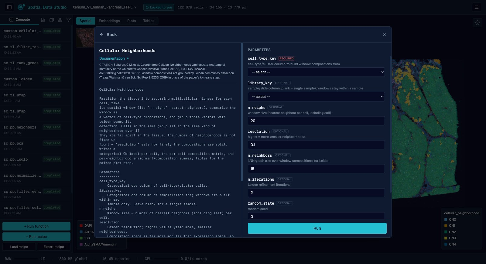
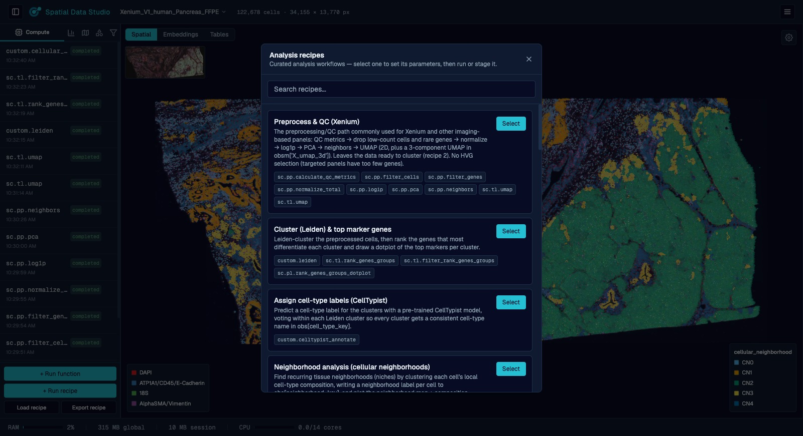
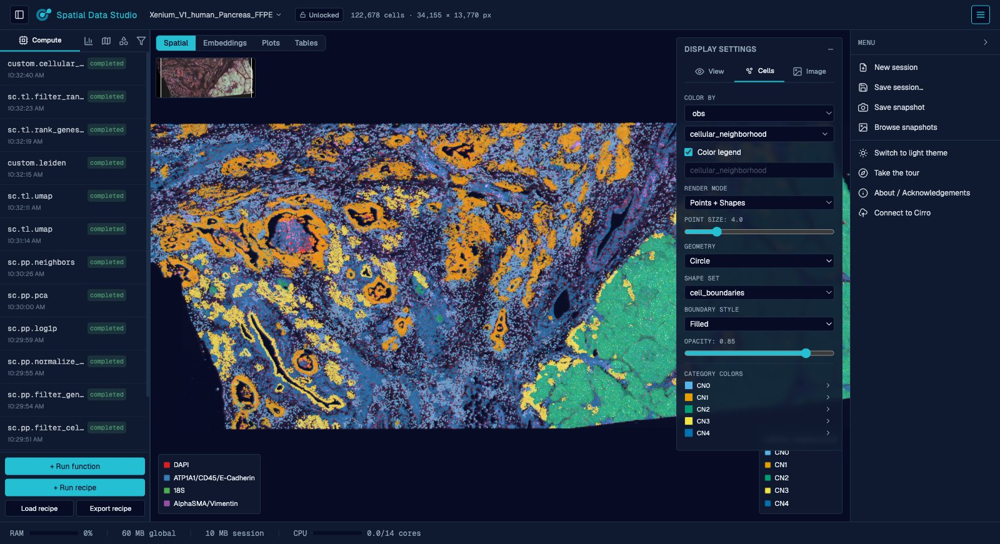
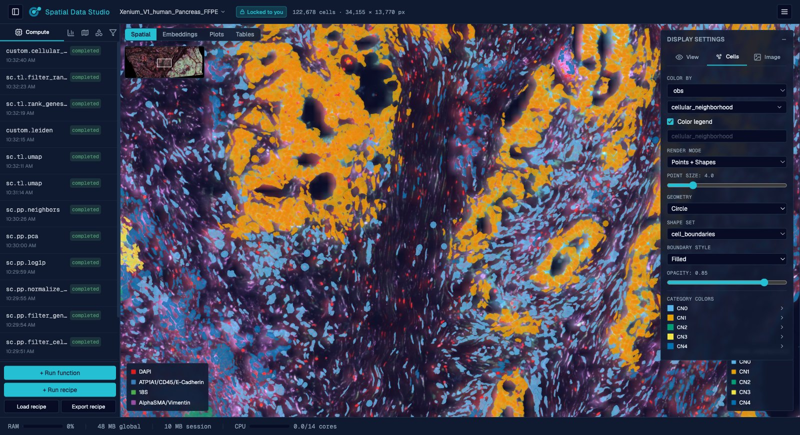

# User guide

Everything Spatial Data Studio does, from the point of view of someone using it. For
how to start the app, see the Docker quickstart in [`README.md`](../README.md#run-it);
for the code, [`DEVELOPMENT.md`](../DEVELOPMENT.md).

Spatial Data Studio opens a spatial transcriptomics dataset (Xenium, Visium, Visium HD,
CosMx, MERSCOPE, or anything else [SpatialData](https://spatialdata.scverse.org/) can
read), runs [`squidpy`](https://squidpy.readthedocs.io/) and
[`scanpy`](https://scanpy.readthedocs.io/) analyses on it through point-and-click forms,
and draws the result on a fast WebGL canvas that puts every cell over the tissue image.

## What you can do

The left panel organizes a session into **Compute**, **Plots**, **Regions**,
**Annotations**, and **Subset** tabs; the canvas fills the rest of the window, with the
display settings in the right-hand sidebar.

### Load your data

Point the app at a raw acquisition folder (a spatialdata-io reader parses it) or open an
existing SpatialData `.zarr` store. Each reader input is its own field: a folder or file
input opens a filesystem picker, and the reader's options (e.g. whether Xenium reads
transcripts, cell boundaries, or the morphology image) are toggles/values — so you tailor
exactly what gets loaded. Large datasets can take a while to read, so the reader's log
streams live while it works. Datasets stay resident in memory for the session. Opening a
`.zarr` store (or `.zarr.zip` / `.zarr.tar.gz` archive) that this app previously saved
also carries the store's recorded compute history into the new session, so the functions
that produced the data stay visible in the Compute tab.

A version saved in the Cirro app opens the same way. In a workspace started on it, its
folder is in the **Open Checkpoint** list under `datasets/` (with the version's title
when that differs), and the Studio assembles it with the store and every version beneath
it. Saving writes a new checkpoint; the version itself is never changed. If a dataset the
version was saved over isn't attached to the workspace, it doesn't open, and the message
names that dataset.

### Run analyses without writing code

Every `squidpy` and (curated) `scanpy` function appears in a searchable picker with a
form generated from the function's own signature — QC, normalization, clustering,
neighborhood enrichment, spatially variable genes, co-occurrence, ligand-receptor, and
more. Each carries a citation and a link to its documentation. Data-transforming
functions run from the **Compute** tab; plotting functions render static figures
collected in a separate **Plots** tab.

### Browse your figures

A **Plots** view sits next to Spatial and Embeddings as a grid of every figure the
session has drawn; click one to fill the screen with it and step through the rest with
the arrow keys. Any figure downloads as SVG, PDF or PNG.

### Apply curated recipes

Multi-step workflows (preprocess → cluster → annotate → neighborhood analysis) you can
run in one click or stage and edit step by step.

<table>
<tr>
<td width="50%"></td>
<td width="50%"></td>
</tr>
<tr>
<td><b>Run a function.</b> Each operation opens with its provenance and a form built from the function's parameters.</td>
<td><b>Apply a recipe.</b> Curated workflows run every step in order, or stage them for editing.</td>
</tr>
</table>

### Visualize interactively

Color cells by any gene or metadata column, choose which tissue-image channels to
display (up to 6 at once) and how they're named, colored (any color, not just presets),
and contrast-adjusted (min/max per channel), switch between point and cell-boundary
rendering, and view non-spatial embeddings (UMAP/PCA) in 2D or 3D — all on the same GPU
canvas. A **minimap** in the canvas' top-left corner shows the whole section with a box
marking the part you're looking at; click or drag it to jump somewhere else.

*Customize the display, organised into **View**, **Cells**, and **Image** icon tabs —
choose what colors the cells (first on the **Cells** tab), how they render, how the
plot is oriented (flip the horizontal/vertical axes), the zoom level (buttons plus
scroll/pinch), whether the minimap is shown, the plot's own light/dark backdrop (on
the **Image** tab, set per plot and independent of the app theme), and how each
tissue-image channel is colored and contrast-adjusted. A dataset that carries more
than one image (say an H&E next to a morphology stain) picks which one is drawn under
the cells at the top of the **Image** tab, or **None** for no image at all; each image
brings its own channels. When cells are colored by a categorical value, each group's
color can be overridden individually (and reset to the default palette) at the bottom
of the **Cells** tab, and the legend on the canvas lists every group, in columns when
there are many. (Text and shape annotations that persist with the dataset are drawn
from the left panel's **Annotations** tab.)*

*Switch to cell-boundary rendering to draw each cell as its actual segmentation
shape rather than a point — pick the shape set (here `cell_boundaries`) and choose
whether each boundary is a filled shape or an outline (with an adjustable line
width), colored by the cell's value either way.*

### Annotate

Select groups of cells to label them, or draw shapes and text directly on the tissue.
Region labels become ordinary metadata columns you can then analyze by. Applying a label
recolors the view by that region set and paints the labelled cells in the color you
picked; the draw color then advances to the next preset for the next group. Labeling
works on the embedding view too — in 3D it labels every cell visible within the drawn
region.

### Select cells

Both the **Regions** and **Subset** tabs pick their cells the same way, with a tool you
choose at the top of the panel:

- **Lasso** — click point after point on the canvas to trace any outline you like, then
  **Finish region** to close it.
- **Circle**, **Ellipse**, **Square**, **Rectangle** — drag once on the canvas and the
  shape appears where you dragged. Then adjust it: drag the shape itself to move it, and
  its side handles to resize — a circle and a square keep their aspect, so they get one
  handle driving both. Everything except the circle also gets a green handle on an arm
  that rotates it. The cell count on the action button follows each adjustment.

A selection can combine areas: **Finish region** banks the shape (or the closed lasso
ring) and frees the canvas for the next one, and the action applies to all of them
together. **Clear** discards the lot.

### Subset

Select a region — on the tissue or an embedding — to spin off a child session that keeps
(or removes) just those cells.

### Share a session safely

Opening a session locks it to you, so a second person who connects can look but not
change anything. A padlock next to the session name shows whether the session is locked
to you, locked to someone else, or unlocked, and lists everyone currently viewing; the
session list shows who holds each session's lock and how many people are on it. You
appear under a two-word name like *gloomy socrates* — click the padlock to rename
yourself, unlock the session so a colleague can take over, or take an unlocked session's
lock. While someone else holds the lock you can still explore freely and change any
display setting (color by, channels, zoom, render mode); those changes stay on your
screen instead of going into the session.

### Save and share

Save a checkpoint you can reopen later — naming the session, picking the folder the file
goes in (a new one is created for you) and the filename it's written under, then choosing
what goes into the file from a checklist of the dataset's elements *and* the figures
you've drawn, each with its size, so you can leave a multi-gigabyte tissue image out of a
copy you want to send someone. The name travels inside the file, so reopening it shows
the name you gave the session however the file itself is named. An image you do keep has
a resolution slider: it lists what each level of the image pyramid costs, and you pick
the most detailed one worth keeping, trading zoomed-in detail for a much smaller file
(the session on screen keeps everything either way). A table you keep breaks out the same
way, into its parts — the gene-expression matrix, the cell and gene tables, each
embedding, layer and neighbor graph — each with its own size and its own checkbox, so an
analysis whose findings live in the annotations can be shared without the expression
matrix that dwarfs them. Such a file keeps everything else and stays fully readable; it
just has no gene expression to color by, and the app says so instead of showing you
zeros. Reopening a checkpoint brings its plots back as pictures, not just as a list of
what was run. Save a **snapshot** — a high-quality figure of the current view exported as
a vector PDF and/or raster PNG, framed and sized in a dialog with a live preview,
optionally with the minimap inset included in the figure — or upload saved checkpoints to
[Cirro](https://cirro.bio/). Saved snapshots are collected in a gallery you can browse,
download, or delete; each file embeds the provenance (view, settings, and the analysis
steps that produced the data).

### Work with an AI assistant

The backend speaks the [Model Context Protocol](https://modelcontextprotocol.io/) at
`/api/mcp`, so an AI agent (e.g. Claude) can drive the same studio you're looking at:
load data, run analyses and recipes, draw and *look at* plots and the tissue view
(renders come back with a world-coordinate grid and an exact pixel→coordinate mapping),
restyle displays, label regions of cells, subset, and save — every change appears in your
browser live. The agent joins the same per-session edit lock you do (it shows up as
*Claude (assistant)* on the padlock while it works, and hands control back when done),
and connects with built-in guidance covering the studio and spatial-omics analysis. From
this repo, `claude` picks the server up automatically via
[`.mcp.json`](../.mcp.json); from anywhere else:
`claude mcp add --transport http spatial-data-studio http://127.0.0.1:8000/api/mcp`
(use your deployment's own host/port for a Docker install, e.g. `:8080`; prefer
`127.0.0.1` over `localhost` locally — the dev backend binds IPv4 only, and `localhost`
can resolve to `::1` and reach some other process squatting the port). The MCP endpoint
is unauthenticated like the rest of the API — expose the port only to people and
processes you'd let edit your sessions.

## Analyses available

The gallery leads with a **guided Xenium region-analysis workflow** you run in order:
preprocess & QC → Leiden cluster & top marker genes → assign cell-type labels
(CellTypist) → neighborhood analysis (cellular neighborhoods) → cell types &
neighborhoods by region → region gene-expression differences.

Beyond that you get the full `squidpy` spatial toolkit (neighborhood enrichment,
Moran's I / Geary's C spatially variable genes, co-occurrence, Ripley's statistics,
ligand-receptor interactions), `scanpy` preprocessing and clustering, and a set of
**spatial / multi-sample methods** that scanpy and squidpy don't provide out of the
box: cellular neighborhoods, Milo differential abundance, LISI integration
diagnostics, proximity/avoidance testing, region-boundary infiltration profiles,
pseudobulk differential expression (DESeq2), and region feature differences
(Kruskal-Wallis). Each is described in
[`backend/app/registry/custom/README.md`](../backend/app/registry/custom/README.md).

## Open a checkpoint without the app running

A saved checkpoint is a single `.zarr.zip` the viewer can read on its own. Open the app
with `?checkpoint=<url>` and it reads that file directly over HTTP range requests: the
tissue image, the cells, the cell-boundary shapes, the text and shape annotations drawn on
the dataset, and every display setting (color by
any obs column or gene, palettes and per-category colors, point size and shape, channel
colors and contrast, legends, layer visibility, pan and zoom) work exactly as they do
live, with no backend and no server to run. It streams only what the current view needs
rather than downloading the file — opening a 438 MB checkpoint and coloring by a gene
costs under a megabyte, and zooming in far enough to draw real segmentation outlines
fetches only the boundaries on screen (about a megabyte out of a 55 MB boundary set).
Boundaries need a checkpoint saved by this version or later; open an older one in the app
and save it again to add them. Any host that serves the file with HTTP range requests
will do — put the built app, your `.zarr.zip` files, and a small `index.json` listing
them in one folder and the page becomes a browsable collection you can switch between.

The viewer also opens SpatialData stores it did not save: a `.zarr.zip`, or a `.zarr/`
folder (point `?checkpoint=` at the folder with a trailing `/`), such as nf-core/sopa or
spatialdata-io output. It finds the table, places the images against the cells, and starts
on the displays a new session would: the spatial view colored by the first categorical
column over the first image, and a UMAP (or other embedding) view when the table has one.
Such a store must be Zarr v3 with consolidated metadata (what spatialdata 0.3 and later
write), and its table needs `obsm["spatial"]`; when one of those is missing the viewer
says which instead of opening an empty view. A store with images and no table at all —
multiplexed imaging not yet segmented, say — opens on the image alone, with its channel
controls and no cells; a checkpoint saved from such a session opens the same way.
Cell boundaries draw from such a store too: each polygon shapes element is offered under
**Cell boundaries**, placed against the cells and colored like them. Without the spatial
index a saved checkpoint carries, the viewer reads an element's outlines whole the first
time it draws them, so a boundary set holding more than 32 MB of geometry is not drawn
from a plain store; save it from this app to get those. Coloring by a gene also reads the
table's whole expression matrix rather than one gene's slice (a few seconds on a 2 GB sopa
store).

The **Plots** view works here too: the figures saved with the checkpoint are in the file,
so the grid, the fullscreen view and the SVG/PDF/PNG downloads all work with no backend.
The left panel opens collapsed and holds one thing: the history of the analysis that
produced the checkpoint — expand it to see each function that was run, and click an entry
for its parameters and timing. The checkpoint's annotations are drawn exactly as the live
app draws them, but can't be selected, moved, edited or deleted, and no new ones can be
added. Anything that would act on the data (running an analysis, annotating, subsetting,
drawing a new plot, saving) needs the live app. You can still
export what you see as a PNG; the publication-quality PDF figure of the current view
isn't available this way.

### Share the exact view you're looking at

In that no-backend viewer, every display setting you change from what the checkpoint was
saved with — color by, palettes and per-category colors, channels and contrast, point
size and shape, legends, layer visibility, where you've panned and zoomed to, and which
view (including a figure you've opened fullscreen) you're on — is kept in the page's
address. **Copy link to this view** in the menu hands you a URL that reopens the same
checkpoint framed and styled exactly as you left it, so a collaborator sees your view
rather than the saved one. Only your changes travel, so the link stays short.

You can try this without installing anything — the
[live demos](https://cirrobio.github.io/spatial-data-studio/demo/) are the real viewer
running in your browser against a hosted checkpoint, over public Visium and Xenium
sections as well as synthetic ones.

## Work in Cirro

Spatial data is big. One Xenium run is a few hundred thousand cells under a morphology
image measured in gigabytes, and a project usually holds several of them, so copying a
section onto a laptop to look at it is the slow part of the work. The alternative is to
run the app next to the data. [Cirro](https://cirro.bio/) is the data platform this app
is built alongside, and it meets the app in three places: a workspace that runs it on
the project's own data, one running app the whole lab can be in at once, and a way to
publish what you found back into the project for people who are running nothing at all.

### Run it where the data is

A Cirro workspace runs a container image inside a project, with that project's datasets
mounted. The app ships as a single image for exactly that —
`public.ecr.aws/cirrobio/spatial-data-studio:v1`, whose tags and environment are in
[`docker/README.md`](../docker/README.md) — and it reads its data folder from the
image's `$HOME`, which is where the workspace puts the project's datasets. So the app
opens on data you never downloaded, nothing is copied back, and the machine doing the
analysis is the workspace's rather than yours: a section too big for a laptop is only a
bigger workspace.

### Be in it together

A workspace is one running app, and everyone in the lab can open it at once. Whoever
opens a session holds its edit lock; everyone else can watch, and each analysis the
lock-holder runs appears on their screens as it finishes rather than on a reload. What
you are *looking* at stays yours — color by a different gene, change the channels, zoom
somewhere else — while someone else drives the analysis, and the padlock hands the lock
over when you want a turn. [Share a session safely](#share-a-session-safely) covers what
the padlock shows and how to take, release, or rename. Sessions are independent of each
other, so two people working on different datasets in the same workspace do not collide;
how many can be resident at once is a setting of the deployment
([`docker/README.md`](../docker/README.md)).

### Publish what you found

You can publish saved checkpoints to [Cirro](https://cirro.bio/) from the menu in the
right-hand sidebar. Each person signs in with their own Cirro account, so several
people can use the same running app without sharing credentials — the server holds no
Cirro credential and needs no Cirro configuration. Setting `CIRRO_BASE_URL` on the
deployment only prefills a domain other than `app.cirro.bio`.

1. **Connect to Cirro** asks for your Cirro domain (for example `app.cirro.bio`) and gives
   you a login link. Open it, sign in as you normally would, and the dialog updates
   itself when you're done — closing it won't cancel the login. Everything else about
   your account is discovered from the domain. A login link is only good for about half
   an hour; come back to a stale one and the dialog says so and offers **Refresh login
   token**, which gets you a fresh link for the same account.
2. The menu entry then reads **Upload to Cirro** and shows which account you're signed
   in as. **Disconnect from Cirro** signs you out of this browser.
3. The upload dialog asks for a project, a dataset name, an optional description and
   destination folder, and which saved sessions to include. Uploading runs in the
   background — you can keep working, and the sidebar shows progress.

Alongside your checkpoints, the upload includes the viewer itself (`index.html`) and an
`index.json` listing them, so the resulting Cirro dataset opens as a browsable
collection that anyone with access can view without running this app. (Uploads made
from a development server, which has no built viewer on disk, carry the checkpoints and
`index.json` only; the dialog tells you which kind of upload you're making.)

Your Cirro sign-in lives only in the running app's memory and is dropped after 8 hours
of inactivity or when you disconnect.

## Spatial Data Studio in your browser, on Cirro

The Cirro app is Spatial Data Studio with no server: a web page that signs in with your
Cirro account, reads your project's spatial data where it is stored, runs its analyses
in your browser, and saves what you find back to the project. Open it at
[cirrobio.github.io/spatial-data-studio/app/](https://cirrobio.github.io/spatial-data-studio/app/).
**Explore example data** opens four example sections with no account, and anything you
save there stays in your browser. **Log In with Cirro** opens your own projects: it asks
which Cirro you use, suggesting the ones it knows as you type their name, and taking the
address you use for any other (such as cirro.example.org). It remembers your choice for
next time. Logging in works once your organization's Cirro has registered the app. When a
Cirro can't be reached or the log-in doesn't finish, the page says why and offers **Try
again** or **Log in to another Cirro**. Signed in, the menu at the top right (your Cirro
and your name) has **Log out** and **Log in to another Cirro** on every page, including
when your account can't see any projects yet.

### The map of a project

A project opens as a map of four stages, each bubble one item sized by its files and
named inside it when there is room:

- **Images**: microscopy and histology images (OME-TIFF and other slide formats).
- **Instrument runs**: raw output from Xenium, Visium, Visium HD, CosMx, MERSCOPE and
  the other platforms Spatial Data Studio's workflow reads, recognized by their files.
- **Spatial data**: SpatialData stores (`.zarr` folders and `.zarr.zip` files), whichever
  pipeline wrote them: Spatial Data Studio's workflow, nf-core/sopa, or a segmentation
  pipeline. A dataset holding several stores shows each one. Rings inside a bubble are
  versions saved on that store.
- **Figures**: figures saved with a version of a store.

Dashed lines join a run or an image to the spatial data made from it. Click a stage to
step inside it: its items are packed by Cirro folder, or regrouped by tag or by month,
with a filter and a list beside them (shown from the start when a stage holds more than
20 items). Click a group to step into it and a bubble to open it. **About** in the top
bar says which version of the app this is and cites the methods it follows.

Each bubble stays itself as you move: stepping into a stage brings its bubbles to the
middle and sends the other stages' bubbles to their places in the rail on the left;
regrouping or stepping into a folder moves them to their new places; a bubble you open
grows into its page and shrinks back into the map when you return.

The app finds these items by reading each dataset's file list once. It keeps what it
found in a sheet in the project (*Spatial Data Studio catalog*), so the next visit, by
anyone, reads only the datasets added since. Where the project can't have that sheet,
the catalog stays in your browser and the top bar says so.

### Open a spatial dataset

A store opens across the whole page, read in place: no copy is downloaded, only the
pieces on screen. Pan and zoom as you would on a map. As in the Studio, the color legend,
the image's channels and an overview of the whole section are drawn on the image itself.
The line above it starts with the way back to the map, names the store, its size and
where it came from, counts its cells (spots, for Visium) and genes, and links the run or
image it was made **from** and what it was **made into**.

Tabs over the top of the view switch what is shown, like the Studio's switch between its
spatial and embedding views:

- **Tissue**: every cell over the image.
- **Cell map**: the store's UMAP or other embedding.
- **Composition**: cells per group of the current color. A color of values rather than
  groups, or of more than 100 groups (too many to color), has nothing to count, and the
  view says so.
- **Versions**: the store's history, with the page to itself (it has nothing to set).
- **Figures**: a menu of the figures saved with it, when there are any.

At the other end of the tabs are a scale bar (when the store says its coordinates are
microns), zoom out and in, and **Fit to data**, which stay in reach when the drawers are
away. For a Visium store, whose observations are capture spots, the header, the map's tab
and Composition say spots rather than cells.

Two drawers float over the view. Pull one in with its tab at the edge of the view and
push it away with its arrow, or press **[** for the left one, **]** for the right one
and **\\** for both at once; the app remembers which you keep open. The left one holds
the **tasks** (below). The right one, **Display**, holds the Studio's own display
settings, the same panel with the same names: **View** (cells and image on or off,
mirroring, zoom, the overview, fit), **Cells** (first what colors the cells, any
annotation, gene or layer, with the color legend and its title; then render mode, point
size and shape, the cell boundaries and their style, opacity, and each category's color)
and **Image** (which image, a light or dark backdrop, and each channel's color, contrast
and name). A store first opens with a light backdrop behind a stained (brightfield)
slide and a dark one behind fluorescence, and the legends and overview take the
backdrop's colors. It opens colored as it was saved, unless that color has a single
group (a column every cell shares), in which case it opens colored by its first grouping
with 2 to 50 groups. A store with no such grouping opens with its cells drawn as
outlines (where it has cell boundaries), so the image shows through them. The tissue and
the cell map share one color: choosing a color, its legend title or a group's color on
one changes the other. On **Composition** the drawer holds just the color, which picks
the groups counted.

### Analyze in the browser

The left drawer lists them. Each runs in your browser, on the data in view:

- **Label cells**: draw around cells (lasso, circle, ellipse, square or rectangle) and
  name them, into a new column or one you have.
- **Find clusters**: Leiden clustering the way scanpy does it by default. Counts are
  normalized and log-transformed, the most variable genes go into a PCA, and Leiden
  works on the cells' nearest-neighbor graph. Resolution is yours to set. The report
  shows each cluster's size and where it is, and how much of the variation the PCA's
  components hold.
- **Compare groups**: a Wilcoxon test of every gene between two groups. A group can be a
  category of any column or the cells you selected on the tissue. The report shows the
  volcano beside maps of where the two groups are, and each side's strongest genes.
- **Marker genes**: each group of a column against all the others. The report shows
  every group's strongest markers in one dot plot, then a card per group: its size,
  where its cells are, and what marks it.
- **Spatially variable genes**: Moran's I of every gene over each cell's six nearest
  neighbors on the tissue. The report maps the strongest genes, and sorts the strongest
  60 into spatial patterns: genes whose maps look alike.
- **Neighborhood enrichment**: how often each pair of groups are neighbors, against
  shuffled labels. The report shows the heatmap, the pairs that sit together and apart
  most, and a card per group saying which groups it neighbors.
- **Cellular niches**: each cell's mix of groups among its nearest neighbors, clustered
  into niches and written as a new column. The report shows what each niche is made of
  and where it is.
- **Save as a figure**: keep the tissue as it is shown, with its colors and framing, as a
  figure, or download it as SVG, PDF or a 300 dpi PNG of what is between the drawers,
  one column (89 mm), two columns (183 mm) or a 16:9 slide wide. Downloads are of the
  tissue, so open the **Tissue** view first. A long legend takes more columns before the
  page grows, and a page stops at 240 mm: groups that still don't fit are left out of the
  legend, and the task says how many. A color of more than 100 groups has no legend.

Each analysis opens as a report across the view when it finishes, and is kept with the
data: in the unsaved changes until you save a version, then in the version. A report
starts with what was run, on which column, with which settings and by whom; then the
numbers that sum it up, its charts, and a card for each group, with the full table
folded at the end. The **Reports** menu over the view and the task drawer list every
report kept here, and **Remove…** takes one out. A report draws only on what was kept
and on data the app never changes, so it reads the same whenever it is opened. Picking a
gene in a report maps it on a thumbnail of the tissue, and from there on the tissue
itself; a report's chart can be saved as a figure.

Where a report shows genes that go together (a group's markers, the genes higher on one
side of a comparison, a spatial pattern), **Score** turns its top 25, or as many as pass
the cutoffs, into one value per cell, as scanpy's `score_genes` does: each cell's mean
expression of the genes, less that of genes expressed at similar levels. The score is a
new column, and the tissue is colored by it.

Gene tasks need the store's expression matrix. Stores saved without one (like three of the four examples) still
offer labelling, neighborhoods, niches and figures, and the drawer names the tasks they
can't run. Clustering is the slowest task:
seconds for tens of thousands of cells, about half a minute for 200,000.

The methods follow scanpy and squidpy and are tested against them, so a result agrees
with what Python gives on the same data, with these differences:

- The Wilcoxon test is always tie-corrected (scanpy's `tie_correct=True`), which gives
  sparse genes somewhat smaller p-values than scanpy's default.
- Cells with no group are left out of "the rest" when one group is compared with all
  the others; scanpy counts them in.
- Leiden partitions differ from scanpy's about as much as two scanpy runs with
  different seeds differ from each other; the number of clusters is much the same.
- The most variable genes are exactly the number asked for; scanpy also keeps genes
  tied at the cutoff. The PCA takes at most 5,000 of them.
- Permutation z-scores (neighborhood enrichment) and gene-set scores draw their random
  samples differently from numpy, so they differ from squidpy's and scanpy's by
  sampling noise.

### Save a version

What a task makes is not saved straight away. It goes into **unsaved changes**, shown in
a bar at the bottom of the page with what they are and how big. **Save as a version**
writes them as a new dataset in the project, holding only what changed: a new column of
labels is kilobytes, beside a store of gigabytes that is not copied. The dataset is
tagged as this app's, filed in the store's Cirro folder, and carries a note saying what
was saved and by whom; the top bar says the catalog is updating while the project is
read again to list it. **Discard** throws the changes away. Until you do one or the
other they are kept in this browser, so a reload loses nothing. Logging out, or logging
in to another Cirro, discards a project's unsaved changes (the app asks first), so the next person to log in on the same
browser can't open them; the examples' changes stay.

Every version names the one it was saved on, by dataset ID. A stack of versions
therefore still opens after its datasets are shared into another project, whether they
are shared together or one by one.

### Versions and history

**Versions** shows a store's history: the original store at the bottom and each version
above the one it was saved on, with what it changed. Open any version to see the data
exactly as it was saved. Saving from an older version starts a branch beside the newer
ones rather than replacing them. Nothing is ever overwritten, so going back is always
just opening an older version.

A version is ordinary SpatialData underneath, so it can also be read from Python:
[`docs/LAYER_FORMAT.md`](LAYER_FORMAT.md) explains how, and what the app keeps in `uns`.

### Images and instrument runs

An image opens across the page with its channels in the right drawer. A run opens with
the metrics its instrument reported. Both list, in the left drawer, the pipelines in
your Cirro that take them further: cell segmentation for an image (Cellpose, StarDist,
nf-core/sopa), and Spatial Data Studio's workflow for a run. These open Cirro's own
launch form for the dataset, so the pipeline's options, cost and permissions are Cirro's
to show. Their output appears on the map as spatial data, linked back to what it was
made from.

### Open it in the full Studio

The browser runs the analyses above; the full Spatial Data Studio runs every squidpy and
scanpy function, on a machine in your project. **Open in the full Studio**, at the top of
any item, starts a Cirro workspace running it with that item attached. **Workspaces**, in
the top bar, lists the workspaces you have in the project and starts one with several
items at once.

- **What it opens.** **+ Add from this project** adds spatial datasets, runs and images.
  A saved version brings the store and every version beneath it, so the Studio opens it
  with all the changes you saved. Changes you haven't saved as a version stay in your
  browser, and the form says so.
- **The machine.** Standard is Cirro's default for the Studio; Large and Extra large
  double and quadruple its CPU and memory, for sections too big for the default.
- **Starting.** A workspace takes a few minutes to start. Keep working meanwhile: the top
  bar shows it starting, and a notice with **Open** appears when it's ready. It opens in
  a new tab, with the items you attached under `datasets/` in the Studio's data folder:
  saved versions and checkpoints in its **Open Checkpoint** list, other stores and
  instrument runs through **Import Data**.
- **Running.** It stops by itself after two hours unless you **Extend** it, and leaving
  this page doesn't stop it. **Stop** keeps its files, and **Start** runs it again.
  **Change datasets** gives a stopped workspace different items or a different machine;
  it restarts with its files kept. **Delete** removes it, with any files in it that
  weren't saved to the project.
- **The limit.** Cirro limits how many workspaces you may have in a project, stopped ones
  included. At the limit, the form lists yours so you can delete one to make room.
- **Results.** What you save in the Studio stays in the workspace until you upload it to
  Cirro from there ([Publish what you found](#publish-what-you-found)); it then appears on
  the map.

A workspace needs your organization's Cirro to offer the Studio's workspace environment;
where it doesn't, the Workspaces sheet says so. The examples don't offer workspaces.

### What it can see and do

The app acts as you, with the permissions your project role gives you and the ones
your organization granted the app; it never sees your password. It reads data by
short-lived signed links straight from the project's storage, and nothing it reads
leaves your browser. It writes only what you save: a version dataset, its note, and the
project's catalog sheet, and the workspaces you start, each with a note of what it
opened.
