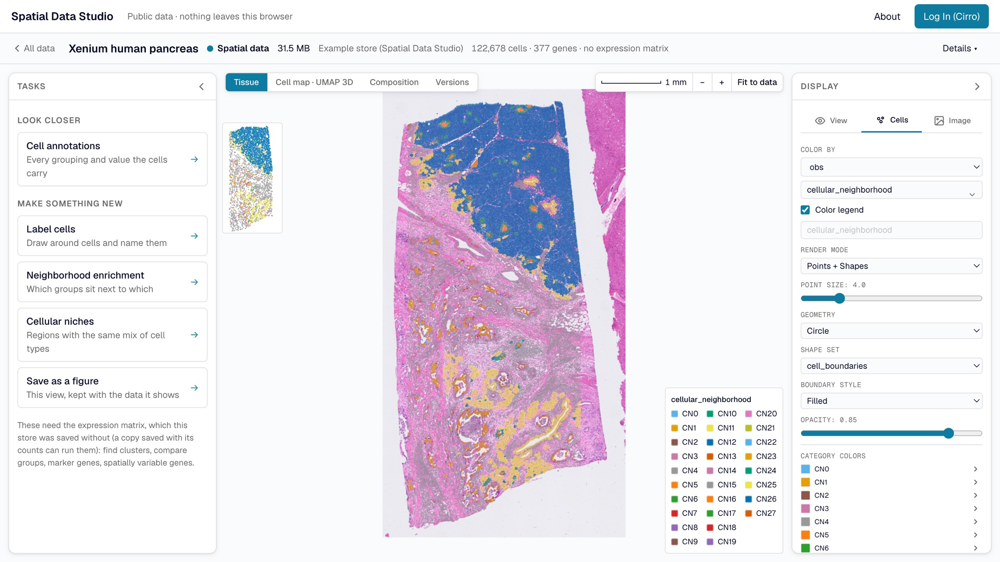

# Introduction

Spatial Data Studio is a web application for looking at and analyzing spatial omics
data. That is a tissue section measured cell by cell (or spot by spot), with each cell's
position, its gene expression and the microscope image it sits in. Open a section and see
every cell over the image. Color the cells by a gene or a cluster, compare regions and
cell types, and keep what you find, without writing code.

It reads Xenium, Visium, Visium HD, CosMx, MERSCOPE, and anything else
[SpatialData](https://spatialdata.scverse.org/) can read. Its analyses follow
[`scanpy`](https://scanpy.readthedocs.io/) and
[`squidpy`](https://squidpy.readthedocs.io/), the standard Python tools for this data.

## Three ways to use it

### In your browser

Most people start with the [web app](https://cirrobio.github.io/spatial-data-studio/),
which needs nothing installed. Its start page offers two ways in:

- **Public Data** opens a set of public sections with no account. Everything runs in
  your browser, and anything you save stays there.
- **Private Data (Cirro)** opens your own projects in [Cirro](https://cirro.bio/), the
  data platform Spatial Data Studio is built with. The app reads your data where Cirro
  stores it and saves what you make back to the project, where everyone on the project
  can open it and build on it.

### In an Analysis Workspace

Some work needs more than a browser can give: a squidpy or scanpy function the web app
doesn't offer, a recipe of several steps, or a section too big for your computer's
memory. An **Analysis Workspace** is the server version of Spatial Data Studio, with every
squidpy and scanpy function, running on a machine in your Cirro project. You start one
from the web app with the datasets you choose, and colleagues can join it once you share
it. You can also run one on your own computer with Docker.

### Inside another page (advanced)

The viewer that draws a section is also something you can put on another web page: a
link that opens a saved section with nothing running behind it, a folder of sections on
any web server, or a frame in a dashboard.

## Which one do I need?

| You want to | Use |
| --- | --- |
| See what the app does, or explore public data | the web app's **Public Data** |
| Look at and analyze your own data, and share results with your team | the web app's **Private Data (Cirro)** |
| Run a squidpy or scanpy function the web app doesn't offer, or a recipe | an Analysis Workspace, started from the web app |
| Work on data on your own computer, or have an AI assistant drive the app | an Analysis Workspace, run with Docker |
| Show a saved section on your own site or dashboard | the viewer |

## In this guide

- [Explore public data](public-data.md): the start page, the four stages of data the
  app works with, the map, and opening a dataset.
- [Your data in Cirro](cirro.md): logging in, what the app finds in a project, pipelines,
  saving versions, and working as a team.
- [Analyze in the browser](analyze.md): the analyses, their reports, figures, and how the
  results compare with scanpy and squidpy.
- [Analysis Workspaces](analysis-workspaces.md): starting one, sharing it, and everything
  it adds.
- [Run it with Docker](docker.md): an Analysis Workspace on your own computer, and the AI
  assistant.
- [Share and embed the viewer](viewer.md): links to a saved section, hosting a
  collection, and putting the viewer on another page.
