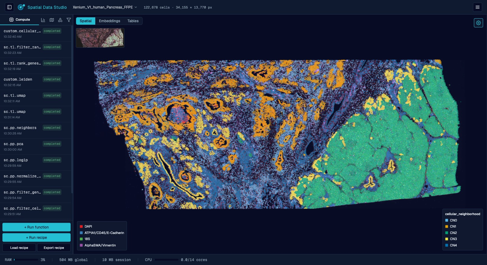

# Analysis Workspaces

An Analysis Workspace is the server version of Spatial Data Studio. It offers every
squidpy and scanpy function through point-and-click forms, curated recipes of several
steps, and the memory of a whole machine for sections too big for a browser. In Cirro it
runs as a workspace in your project, with the datasets you choose attached; on your own
computer it runs with Docker ([Run it with Docker](docker.md)). Either way you use it in
your browser, and it looks like this:

*A whole Xenium ovarian-cancer section (~400,000 cells), colored by cellular
neighborhood.*

## Start one from the web app

**Open in an Analysis Workspace**, at the top of any item in the web app, starts one with
that item attached. **Workspaces**, in the top bar, lists the Analysis Workspaces you have
in the project and starts one with several items at once. You can also create one on
Cirro's own Workspaces page, from the Spatial Data Studio environment.

The datasets are attached in place, read-only: nothing is downloaded and nothing is
copied back, and the machine doing the analysis is the workspace's rather than yours, so
a section too big for a laptop only needs a bigger machine.

- **What it opens.** **+ Add from this project** adds spatial datasets, runs and images.
  A saved version brings the store and every version beneath it, so the workspace opens
  it with all the changes you saved. Changes you haven't saved as a version stay in your
  browser, and the form says so.
- **The machine.** Standard is Cirro's default for an Analysis Workspace; Large and Extra
  large double and quadruple its CPU and memory, for sections too big for the default. It
  is billed to the project while it runs.
- **Starting.** A workspace takes a few minutes to start. Keep working meanwhile: the top
  bar shows it starting, and a notice with **Open** appears when it's ready. It opens in
  a new tab, with the items you attached under `datasets/` in its data folder: saved
  versions and checkpoints in its **Open Checkpoint** list, other stores and instrument
  runs through **Import Data**.
- **Running.** It stops by itself after two hours unless you **Extend** it, and leaving
  the web app doesn't stop it. **Stop** keeps its files, and **Start** runs it again.
  **Change datasets** gives a stopped workspace different items or a different machine;
  it restarts with its files kept. **Delete** removes it, with any files in it that
  weren't saved to the project.
- **The limit.** Cirro limits how many workspaces you may have in a project, stopped ones
  included. At the limit, the form lists yours so you can delete one to make room.
- **Results.** What you save in an Analysis Workspace stays in it until you
  [publish it to Cirro](#publish-to-cirro); it then appears on the web app's map.

Analysis Workspaces need your organization's Cirro to offer the Spatial Data Studio
workspace environment; where it doesn't, the Workspaces sheet says so. Public Data
doesn't offer them.

## Work in it together

An Analysis Workspace is one running app, and more than one person can be in it at once.
The web app starts it as yours alone. To let colleagues in, share it from Cirro's own page
for the workspace: shared **Read-Write**, anyone on the project can connect to it (Cirro's
[Sharing a workspace](https://docs.cirro.bio/features/workspaces/overview/#sharing-a-workspace)
has the options).

Whoever opens a session holds its edit lock; everyone else can watch, and each analysis
the lock-holder runs appears on their screens as it finishes rather than on a reload.
What you are *looking* at stays yours: color by a different gene, change the channels,
zoom somewhere else, while someone else drives the analysis, and the padlock hands the
lock over when you want a turn. Sessions are independent of each other, so two people
working on different datasets in the same workspace do not collide; how many can be open
at once is a setting of the deployment
([`docker/README.md`](../../docker/README.md)).

### The padlock

Opening a session locks it to you, so a second person who connects can look but not
change anything. A padlock next to the session name shows whether the session is locked
to you, locked to someone else, or unlocked, and lists everyone currently viewing; the
session list shows who holds each session's lock and how many people are on it. You
appear under a two-word name like *gloomy socrates*. Click the padlock to rename
yourself, unlock the session so a colleague can take over, or take an unlocked session's
lock. While someone else holds the lock you can still explore freely and change any
display setting (color by, channels, zoom, render mode); those changes stay on your
screen instead of going into the session.

## Find your way around

The left panel organizes a session into **Compute**, **Plots**, **Regions**,
**Annotations**, and **Subset** tabs; the canvas fills the rest of the window, with the
display settings in the right-hand sidebar.

### Load your data

Point the app at a raw acquisition folder (a spatialdata-io reader parses it) or open an
existing SpatialData `.zarr` store. Each reader input is its own field: a folder or file
input opens a filesystem picker, and the reader's options (e.g. whether Xenium reads
transcripts, cell boundaries, or the morphology image) are toggles/values — so you tailor
exactly what gets loaded. Large datasets can take a while to read, so the reader's log
streams live while it works. Datasets stay resident in memory for the session. Opening a
`.zarr` store (or `.zarr.zip` / `.zarr.tar.gz` archive) that this app previously saved
also carries the store's recorded compute history into the new session, so the functions
that produced the data stay visible in the Compute tab.

A version saved in the web app opens the same way. In a workspace started on it, its
folder is in the **Open Checkpoint** list under `datasets/` (with the version's title
when that differs), and the Analysis Workspace assembles it with the store and every
version beneath it. Saving writes a new checkpoint; the version itself is never changed.
If a dataset the version was saved over isn't attached to the workspace, it doesn't
open, and the message names that dataset.

### Run analyses without writing code

Every `squidpy` and (curated) `scanpy` function appears in a searchable picker with a
form generated from the function's own signature — QC, normalization, clustering,
neighborhood enrichment, spatially variable genes, co-occurrence, ligand-receptor, and
more. Each carries a citation and a link to its documentation. Data-transforming
functions run from the **Compute** tab; plotting functions render static figures
collected in a separate **Plots** tab.

### Apply curated recipes

Multi-step workflows (preprocess → cluster → annotate → neighborhood analysis) you can
run in one click or stage and edit step by step.

<table>
<tr>
<td width="50%"></td>
<td width="50%"></td>
</tr>
<tr>
<td><b>Run a function.</b> Each operation opens with its provenance and a form built from the function's parameters.</td>
<td><b>Apply a recipe.</b> Curated workflows run every step in order, or stage them for editing.</td>
</tr>
</table>

### Browse your figures

A **Plots** view sits next to Spatial and Embeddings as a grid of every figure the
session has drawn; click one to fill the screen with it and step through the rest with
the arrow keys. Any figure downloads as SVG, PDF or PNG.

### Visualize interactively

Color cells by any gene or metadata column, choose which tissue-image channels to
display (up to 6 at once) and how they're named, colored (any color, not just presets),
and contrast-adjusted (min/max per channel), switch between point and cell-boundary
rendering, and view non-spatial embeddings (UMAP/PCA) in 2D or 3D — all on the same GPU
canvas. A **minimap** in the canvas' top-left corner shows the whole section with a box
marking the part you're looking at; click or drag it to jump somewhere else.

*Customize the display, organised into **View**, **Cells**, and **Image** icon tabs —
choose what colors the cells (first on the **Cells** tab), how they render, how the
plot is oriented (flip the horizontal/vertical axes), the zoom level (buttons plus
scroll/pinch), whether the minimap is shown, the plot's own light/dark backdrop (on
the **Image** tab, set per plot and independent of the app theme), and how each
tissue-image channel is colored and contrast-adjusted. A dataset that carries more
than one image (say an H&E next to a morphology stain) picks which one is drawn under
the cells at the top of the **Image** tab, or **None** for no image at all; each image
brings its own channels. When cells are colored by a categorical value, each group's
color can be overridden individually (and reset to the default palette) at the bottom
of the **Cells** tab, and the legend on the canvas lists every group, in columns when
there are many. (Text and shape annotations that persist with the dataset are drawn
from the left panel's **Annotations** tab.)*

*Switch to cell-boundary rendering to draw each cell as its actual segmentation
shape rather than a point — pick the shape set (here `cell_boundaries`) and choose
whether each boundary is a filled shape or an outline (with an adjustable line
width), colored by the cell's value either way.*

### Annotate

Select groups of cells to label them, or draw shapes and text directly on the tissue.
Region labels become ordinary metadata columns you can then analyze by. Applying a label
recolors the view by that region set and paints the labelled cells in the color you
picked; the draw color then advances to the next preset for the next group. Labeling
works on the embedding view too — in 3D it labels every cell visible within the drawn
region.

### Select cells

Both the **Regions** and **Subset** tabs pick their cells the same way, with a tool you
choose at the top of the panel:

- **Lasso** — click point after point on the canvas to trace any outline you like, then
  **Finish region** to close it.
- **Circle**, **Ellipse**, **Square**, **Rectangle** — drag once on the canvas and the
  shape appears where you dragged. Then adjust it: drag the shape itself to move it, and
  its side handles to resize — a circle and a square keep their aspect, so they get one
  handle driving both. Everything except the circle also gets a green handle on an arm
  that rotates it. The cell count on the action button follows each adjustment.

A selection can combine areas: **Finish region** banks the shape (or the closed lasso
ring) and frees the canvas for the next one, and the action applies to all of them
together. **Clear** discards the lot.

### Subset

Select a region — on the tissue or an embedding — to spin off a child session that keeps
(or removes) just those cells.

## Analyses available

The gallery leads with a **guided Xenium region-analysis workflow** you run in order:
preprocess & QC → Leiden cluster & top marker genes → assign cell-type labels
(CellTypist) → neighborhood analysis (cellular neighborhoods) → cell types &
neighborhoods by region → region gene-expression differences.

Beyond that you get the full `squidpy` spatial toolkit (neighborhood enrichment,
Moran's I / Geary's C spatially variable genes, co-occurrence, Ripley's statistics,
ligand-receptor interactions), `scanpy` preprocessing and clustering, and a set of
**spatial / multi-sample methods** that scanpy and squidpy don't provide out of the
box: cellular neighborhoods, Milo differential abundance, LISI integration
diagnostics, proximity/avoidance testing, region-boundary infiltration profiles,
pseudobulk differential expression (DESeq2), and region feature differences
(Kruskal-Wallis). Each is described in
[Analysis methods](../../backend/app/registry/custom/README.md).

## Save checkpoints and snapshots

Save a checkpoint you can reopen later — naming the session, picking the folder the file
goes in (a new one is created for you) and the filename it's written under, then choosing
what goes into the file from a checklist of the dataset's elements *and* the figures
you've drawn, each with its size, so you can leave a multi-gigabyte tissue image out of a
copy you want to send someone. The name travels inside the file, so reopening it shows
the name you gave the session however the file itself is named. An image you do keep has
a resolution slider: it lists what each level of the image pyramid costs, and you pick
the most detailed one worth keeping, trading zoomed-in detail for a much smaller file
(the session on screen keeps everything either way). A table you keep breaks out the same
way, into its parts — the gene-expression matrix, the cell and gene tables, each
embedding, layer and neighbor graph — each with its own size and its own checkbox, so an
analysis whose findings live in the annotations can be shared without the expression
matrix that dwarfs them. Such a file keeps everything else and stays fully readable; it
just has no gene expression to color by, and the app says so instead of showing you
zeros. Reopening a checkpoint brings its plots back as pictures, not just as a list of
what was run.

Save a **snapshot** — a high-quality figure of the current view exported as a vector PDF
and/or raster PNG, framed and sized in a dialog with a live preview, optionally with the
minimap inset included in the figure. Saved snapshots are collected in a gallery you can
browse, download, or delete; each file embeds the provenance (view, settings, and the
analysis steps that produced the data).

A saved checkpoint also opens in the viewer, with no Analysis Workspace running:
[Share and embed the viewer](viewer.md).

## Publish to Cirro

You can publish saved checkpoints to [Cirro](https://cirro.bio/) from the menu in the
right-hand sidebar. Each person signs in with their own Cirro account, so several
people can use the same running app without sharing credentials — the server holds no
Cirro credential and needs no Cirro configuration. Setting `CIRRO_BASE_URL` on the
deployment only prefills a domain other than `app.cirro.bio`.

1. **Connect to Cirro** asks for your Cirro domain (for example `app.cirro.bio`) and gives
   you a login link. Open it, sign in as you normally would, and the dialog updates
   itself when you're done — closing it won't cancel the login. Everything else about
   your account is discovered from the domain. A login link is only good for about half
   an hour; come back to a stale one and the dialog says so and offers **Refresh login
   token**, which gets you a fresh link for the same account.
2. The menu entry then reads **Upload to Cirro** and shows which account you're signed
   in as. **Disconnect from Cirro** signs you out of this browser.
3. The upload dialog asks for a project, a dataset name, an optional description and
   destination folder, and which saved sessions to include. Uploading runs in the
   background — you can keep working, and the sidebar shows progress.

The upload becomes a new dataset in the project, which the web app's map shows as spatial
data. Alongside your checkpoints, it includes the viewer itself (`index.html`) and an
`index.json` listing them, so the dataset also opens in Cirro as a browsable collection
that anyone with access can view. (Uploads made from a development server, which has no
built viewer on disk, carry the checkpoints and `index.json` only; the dialog tells you
which kind of upload you're making.)

Your Cirro sign-in lives only in the running app's memory and is dropped after 8 hours
of inactivity or when you disconnect.
