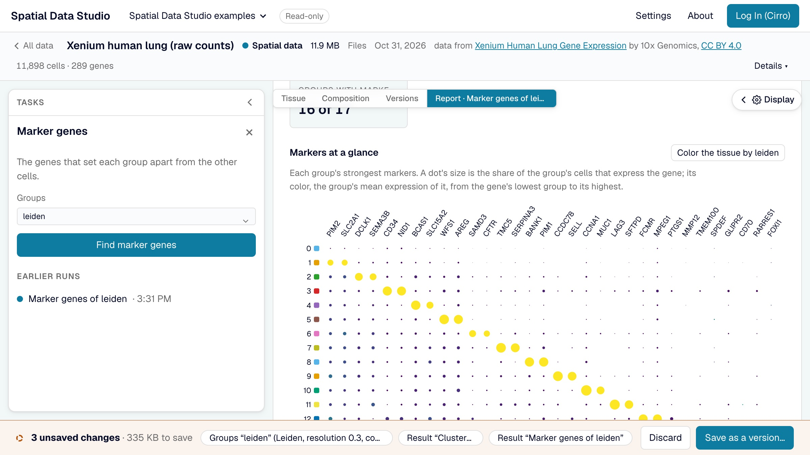

# Analyze in the browser

The left drawer of an [opened section](look-at-a-section.md#drawers) lists the analyses.
Each one runs in your browser, on the data in view, and nothing is sent anywhere to
compute it. What it makes is kept with the data: in the
[unsaved changes](glossary.md#unsaved-changes) until you
[save a version](cirro.md#save-a-version), then in the version.

## The analyses

- **Label cells**: draw around cells and name them, into a new column (*labels* unless you
  name another) or one you have. With the lasso, drag around the cells (each loop adds to
  the selection when you let go) or click point by point; or drag a circle, ellipse, square
  or rectangle. While you draw, hold Space and drag to pan.
- **Find clusters**: Leiden clustering the way scanpy does it by default. Counts are
  normalized and log-transformed, the most variable genes go into a PCA, and Leiden
  works on the cells' nearest-neighbor graph. Resolution is yours to set. The report
  shows each cluster's size and where it is, and how much of the variation the PCA's
  components hold.
- **Compare groups**: a Wilcoxon test of every gene between two groups. A group can be a
  category of any column or the cells you selected on the tissue. A column with more
  than 100 groups, such as one of cell IDs, can't be compared. The report shows the
  volcano beside maps of where the two groups are, and each side's strongest genes.
- **Marker genes**: each group of a column against all the others. The report shows
  every group's strongest markers in one dot plot, then a card per group: its size,
  where its cells are, and what marks it.
- **Spatially variable genes**: Moran's I of every gene over each cell's six nearest
  neighbors on the tissue. The report maps the strongest genes, and sorts the strongest
  60 into spatial patterns: genes whose maps look alike.
- **Neighborhood enrichment**: how often each pair of groups are neighbors, against
  shuffled labels. The report shows the heatmap, the pairs that sit together and apart
  most, and a card per group saying which groups it neighbors.
- **Cellular niches**: each cell's mix of groups among its nearest neighbors, clustered
  into niches and written as a new column. The report shows what each niche is made of
  and where it is.

An analysis that works on groups starts on the column the tissue is colored by, when
that column has groups (at least two, and no more than 100); choose another as you like.

The gene analyses need the store's expression matrix. Stores saved without one still
offer labelling, neighborhoods, niches and figures, and the drawer names the analyses they
can't run. An analysis shows that it is running, with **Cancel**, from the moment you
start it. The first gene analysis on a store reads its expression matrix, with a
progress bar: for the larger public examples that is around 100 MB, about ten seconds on
a good connection. The page stays usable while it reads, and later analyses of the same
store, or of any version of it, reuse it. Clustering is the slowest: seconds for tens of thousands of cells, about
half a minute for 200,000.

## Compare composition

The **Composition** tab counts the cells in each group of what the tissue is colored
by. Choose a column under **Across**, in its Display drawer, and it counts them across
that column's groups instead: cell types or Leiden clusters across regions, say, or
cellular neighborhoods across the areas you drew with **Label cells** (the *labels*
column). Cells with no group in either column are left out, and the view says how many.
A column of more than 100 groups can't be counted across. **Count the whole tissue**
goes back to one bar per group.

The comparison shows:

- a stacked bar for each group of the **Across** column, split into the shares of the
  counted groups in the tissue's colors, under an **Overall** bar of every cell
  counted, the mix each group is compared with. Point at a segment for its count;
- a heatmap of log2 observed over expected: the cells of each counted group in each
  **Across** group, over the number there would be if that group had the overall mix.
  Red is more, blue is fewer;
- every pair in a table: its cells, their share of the **Across** group and of the
  counted group, the cells expected, log2 enrichment, z, p and adjusted p, with
  **Download CSV**.

Each pair is tested with a chi-square test of its 2 × 2 table (in this **Across**
group or not, in this counted group or not), without continuity correction, and the
p-values of all the pairs are Benjamini–Hochberg adjusted together. A pair with an
adjusted p below 0.05 gets a dot on the heatmap. A pair expected to hold fewer than 5
cells isn't tested, and its square is blank. The test counts every cell as independent,
as the gene tests do. Neighboring cells are alike, and the regions of one section are
not replicates, so on a large section almost any difference you can see passes: read
the shade as the size of the difference, and compare sections before claiming that a
condition changes the mix.

**Keep as a report** keeps the comparison with the data, like an analysis's report, and
opens it. In the report, the bars and the heatmap can each be saved as a figure.

## Reports

Each analysis opens as a report across the view when it finishes. A report starts with
what was run, on which column, with which settings and by whom; then the numbers that
sum it up, its charts, and a card for each group, with the full table folded at the end.
**Download CSV**, beside the full table (and beside the neighborhood heatmap), saves the
whole table, every row (every group's, for marker genes), as a CSV file named after the
report, such as `markers-leiden.csv`. Its columns are the table's, and its numbers are
the values themselves rather than the rounded ones on screen: shares as fractions of 1,
and adjusted p-values in full.
The **Reports** menu over the view and the task drawer list every report kept here, and
**Remove…** takes one out. A report draws only on what was kept and on data the app
never changes, so it reads the same whenever it is opened. Picking a gene in a report
maps it on a thumbnail of the tissue, and from there on the tissue itself; a report's
chart can be saved as a figure.

## Score a gene set

Where a report shows genes that go together (a group's markers, the genes higher on one
side of a comparison, a spatial pattern), **Score** turns its top 25, or as many as pass
the cutoffs, into one value per cell, as scanpy's `score_genes` does: each cell's mean
expression of the genes, less that of genes expressed at similar levels. The score is a
new column, and the tissue is colored by it.

## Keep a figure

**Save as a figure**, in the task drawer, takes the view open now, the tissue or the cell
map, with its colors and framing. **Download** saves it as a 300 dpi PNG, a PDF or an SVG
of what is between the drawers, one column (89 mm), two columns (183 mm) or a 16:9 slide
wide, and the task names the file it downloaded; a download of the tissue has a scale bar
when the data is in microns. **Keep with the data** saves the figure with the version
instead. A long legend takes more columns before the page grows, and a page stops at
240 mm: groups that still don't fit are left out of the legend, and the task says how many.
A color of more than 100 groups has no legend. A color by a number has a colorbar over the
same range as the view, with ≥ or ≤ at an end the values run past.

Once a view is kept, the button reads **Kept with the data** until you pan or zoom, change
how the view is drawn, or change the title, caption or size, so the same figure can't be
kept twice. While the figure is only in the unsaved changes, **Take it out**, in the note
under the button, takes it back out and leaves the rest of the changes as they are.

A kept figure is saved with the version, listed under the **Figures** tab and on the
map's Figures stage, and opens framed as it was. With a figure open, **Remove…** under
its caption in the Display drawer takes it out: out of the unsaved changes, or, for a
figure saved in an earlier version, out of the next version you save. The version that
kept it still has it, under **Versions**, but the map's Figures stage no longer lists it.

## How the results compare with scanpy and squidpy

The methods follow scanpy and squidpy and are tested against them, so a result agrees
with what Python gives on the same data, with these differences:

- The Wilcoxon test is always tie-corrected (scanpy's `tie_correct=True`), which gives
  sparse genes somewhat smaller p-values than scanpy's default.
- Cells with no group are left out of "the rest" when one group is compared with all
  the others; scanpy counts them in.
- Leiden partitions differ from scanpy's about as much as two scanpy runs with
  different seeds differ from each other; the number of clusters is much the same.
- The most variable genes are exactly the number asked for; scanpy also keeps genes
  tied at the cutoff. The PCA takes at most 5,000 of them.
- Permutation z-scores (neighborhood enrichment) and gene-set scores draw their random
  samples differently from numpy, so they differ from squidpy's and scanpy's by
  sampling noise.
- A composition's tests agree with `scipy.stats.chi2_contingency(..., correction=False)`
  on each pair's 2 × 2 table. An Analysis Workspace's *Region composition* runs one
  chi-square test of the whole table instead, which says whether the mix differs
  anywhere rather than where.

## Cite the methods

A result from these analyses rests on these methods, and on the format the app reads:

- Wolf, F.A., Angerer, P. & Theis, F.J. SCANPY: large-scale single-cell gene expression
  data analysis. *Genome Biol* 19, 15 (2018).
  [doi:10.1186/s13059-017-1382-0](https://doi.org/10.1186/s13059-017-1382-0)
- Palla, G., Spitzer, H., Klein, M. et al. Squidpy: a scalable framework for spatial omics
  analysis. *Nat Methods* 19, 171-178 (2022).
  [doi:10.1038/s41592-021-01358-2](https://doi.org/10.1038/s41592-021-01358-2)
- Traag, V.A., Waltman, L. & van Eck, N.J. From Louvain to Leiden: guaranteeing
  well-connected communities. *Sci Rep* 9, 5233 (2019).
  [doi:10.1038/s41598-019-41695-z](https://doi.org/10.1038/s41598-019-41695-z)
- Marconato, L., Palla, G., Yamauchi, K.A. et al. SpatialData: an open and universal data
  framework for spatial omics. *Nat Methods* 22, 58-62 (2025).
  [doi:10.1038/s41592-024-02212-x](https://doi.org/10.1038/s41592-024-02212-x)

## When the browser isn't enough

The browser runs the analyses above. For any other squidpy or scanpy function, for a
recipe of several steps, or for a section too big for your computer, open the dataset
in an [Analysis Workspace](analysis-workspaces.md).
