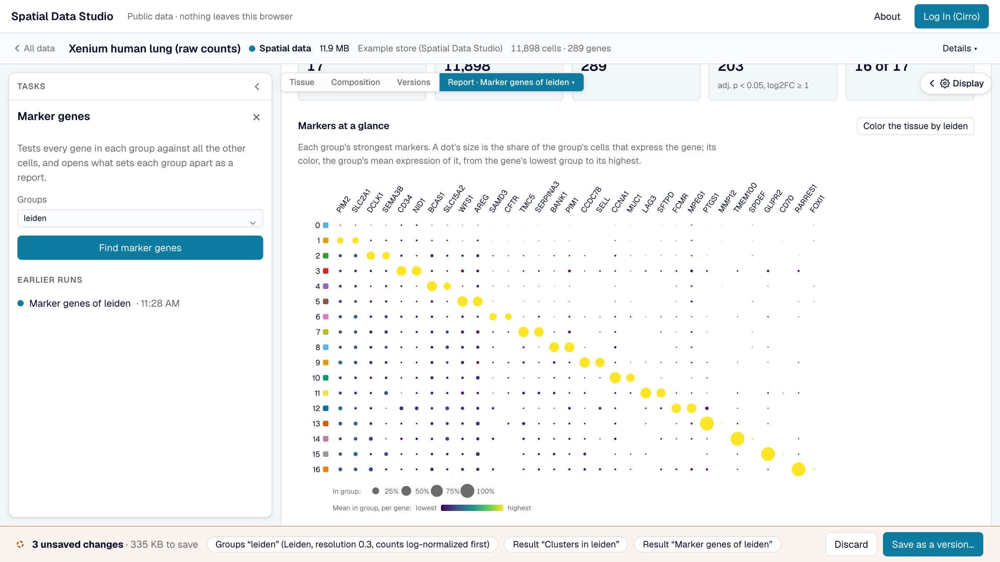

# Analyze in the browser

The left drawer of an [opened spatial dataset](public-data.md#open-a-spatial-dataset)
lists the analyses. Each one runs in your browser, on the data in view, and nothing is
sent anywhere to compute it. What it makes is kept with the data: in the unsaved changes
until you [save a version](cirro.md#save-a-version), then in the version.

## The analyses

- **Label cells**: draw around cells (lasso, circle, ellipse, square or rectangle) and
  name them, into a new column or one you have.
- **Find clusters**: Leiden clustering the way scanpy does it by default. Counts are
  normalized and log-transformed, the most variable genes go into a PCA, and Leiden
  works on the cells' nearest-neighbor graph. Resolution is yours to set. The report
  shows each cluster's size and where it is, and how much of the variation the PCA's
  components hold.
- **Compare groups**: a Wilcoxon test of every gene between two groups. A group can be a
  category of any column or the cells you selected on the tissue. The report shows the
  volcano beside maps of where the two groups are, and each side's strongest genes.
- **Marker genes**: each group of a column against all the others. The report shows
  every group's strongest markers in one dot plot, then a card per group: its size,
  where its cells are, and what marks it.
- **Spatially variable genes**: Moran's I of every gene over each cell's six nearest
  neighbors on the tissue. The report maps the strongest genes, and sorts the strongest
  60 into spatial patterns: genes whose maps look alike.
- **Neighborhood enrichment**: how often each pair of groups are neighbors, against
  shuffled labels. The report shows the heatmap, the pairs that sit together and apart
  most, and a card per group saying which groups it neighbors.
- **Cellular niches**: each cell's mix of groups among its nearest neighbors, clustered
  into niches and written as a new column. The report shows what each niche is made of
  and where it is.

The gene analyses need the store's expression matrix. Stores saved without one (like
three of the four public sections) still offer labelling, neighborhoods, niches and
figures, and the drawer names the analyses they can't run. Clustering is the slowest:
seconds for tens of thousands of cells, about half a minute for 200,000.

## Reports

Each analysis opens as a report across the view when it finishes. A report starts with
what was run, on which column, with which settings and by whom; then the numbers that
sum it up, its charts, and a card for each group, with the full table folded at the end.
The **Reports** menu over the view and the task drawer list every report kept here, and
**Remove…** takes one out. A report draws only on what was kept and on data the app
never changes, so it reads the same whenever it is opened. Picking a gene in a report
maps it on a thumbnail of the tissue, and from there on the tissue itself; a report's
chart can be saved as a figure.

## Score a gene set

Where a report shows genes that go together (a group's markers, the genes higher on one
side of a comparison, a spatial pattern), **Score** turns its top 25, or as many as pass
the cutoffs, into one value per cell, as scanpy's `score_genes` does: each cell's mean
expression of the genes, less that of genes expressed at similar levels. The score is a
new column, and the tissue is colored by it.

## Keep a figure

**Save as a figure**, in the task drawer, keeps the tissue as it is shown, with its colors
and framing, as a figure, or downloads it as SVG, PDF or a 300 dpi PNG of what is between
the drawers, one column (89 mm), two columns (183 mm) or a 16:9 slide wide. Downloads are
of the tissue, so open the **Tissue** view first. A long legend takes more columns before
the page grows, and a page stops at 240 mm: groups that still don't fit are left out of
the legend, and the task says how many. A color of more than 100 groups has no legend.

A kept figure is saved with the version, listed under the **Figures** tab and on the
map's Figures stage, and opens framed as it was.

## How the results compare with scanpy and squidpy

The methods follow scanpy and squidpy and are tested against them, so a result agrees
with what Python gives on the same data, with these differences:

- The Wilcoxon test is always tie-corrected (scanpy's `tie_correct=True`), which gives
  sparse genes somewhat smaller p-values than scanpy's default.
- Cells with no group are left out of "the rest" when one group is compared with all
  the others; scanpy counts them in.
- Leiden partitions differ from scanpy's about as much as two scanpy runs with
  different seeds differ from each other; the number of clusters is much the same.
- The most variable genes are exactly the number asked for; scanpy also keeps genes
  tied at the cutoff. The PCA takes at most 5,000 of them.
- Permutation z-scores (neighborhood enrichment) and gene-set scores draw their random
  samples differently from numpy, so they differ from squidpy's and scanpy's by
  sampling noise.

## When the browser isn't enough

The browser runs the analyses above. For any other squidpy or scanpy function, for a
recipe of several steps, or for a section too big for your computer, open the dataset
in an [Analysis Workspace](analysis-workspaces.md).
