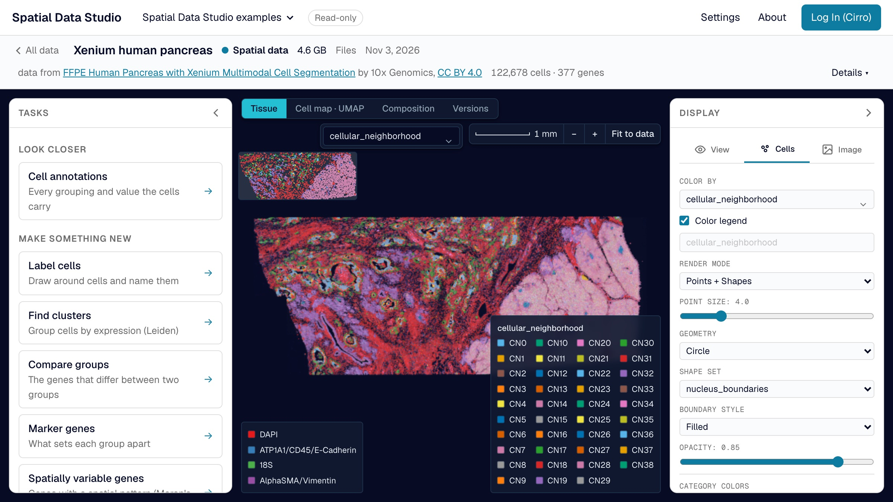

# Look at a section

Click an item of spatial data on the [map](find-a-dataset.md#the-map), and its
[store](glossary.md#store) opens across the whole page: one [section](glossary.md#section),
every cell over the tissue image. It is read in place: no copy is downloaded, only the
pieces on screen. Pan and zoom as you would on a map. The color legend, the image's
channels and an overview of the whole section are drawn on the image itself.

The line above it starts with the way back to the map, names the store, its size and
where it came from, counts its cells (spots, for Visium) and genes, and links the run or
image it was made **from** and what it was **made into**. A [version](glossary.md#version)
shows as *Version N · its title* beside the name of the store it was saved on, and keeps
that store's credit. Esc closes menus and an open task, but never leaves the dataset: the
way back does.

## Tabs

Tabs over the top of the view switch what is shown:

- **Tissue**: every cell over the image.
- **Cell map**: the store's UMAP or other embedding.
- **Composition**: cells per group of the current color, or, with a column chosen under
  **Across**, how each of that column's groups is made up
  ([Compare composition](analyze.md#compare-composition)). A color of values rather than
  groups, or of more than 100 groups (too many to color), has nothing to count, and the
  view says so.
- **Versions**: the store's history, with the page to itself (it has nothing to set).
- **Figures**: a menu of the figures saved with it, when there are any.

Beside the tabs are **Color by** (the same box as in the Display drawer, below: type a
gene's or an annotation's name and pick it), a scale bar (when the store says its
coordinates are microns), zoom out and in, and **Fit to data**, which stay in reach when
the drawers are away; when the view is narrow they move under the tabs. For a Visium
store, whose observations are capture spots, the header, the map's tab, Composition and
Label cells say spots rather than cells.

## Drawers

Two drawers float over the view. Pull one in with its tab at the edge of the view and
push it away with its arrow, or press **[** for the left one, **]** for the right one
and **\\** for both at once; the app remembers which you keep open. In a window narrower
than 1,100 pixels only one is out at a time.

- **The left drawer** holds the analysis tasks ([Analyze in the browser](analyze.md)).
- **Display**, the right drawer, holds the display settings, the same panel with the same
  names as in an Analysis Workspace: **View** (cells and image on or off, mirroring, zoom,
  the overview, fit), **Cells** (first **Color by**, with the color range when the color
  is a number, and the color legend and its title; then render mode, point size and
  shape, the cell boundaries and their style, opacity, and each category's color) and
  **Image** (which image, a light or dark backdrop, and each channel's color, contrast
  and name).

**Color by** is one search box: click it to list the store's
[annotations](glossary.md#annotation), groupings first, or type a gene's name to find it.
Arrow keys and Enter pick from the list and Esc closes it. When the store has layers,
**Gene values** below it picks whether a gene is read from the expression matrix or from
one of them.

## How a section first opens

A store first opens with a light backdrop behind a stained (brightfield) slide and a dark
one behind fluorescence, and the legends and overview take the backdrop's colors. It
opens colored as it was saved, unless that color has a single group (a column every cell
shares), in which case it opens colored by its first grouping with 2 to 50 groups. A
store with no such grouping opens with its cells drawn as outlines (where it has cell
boundaries), so the image shows through them. A gene or other number is colored from the
1st to the 99th percentile of the cells' non-zero values (from zero when some cells are
zero), so a few cells with very high counts don't leave the rest of the tissue dark; cells
past either end take its color, and the legend marks that end with ≥ or ≤. **Color
range** sets the range by hand and **Reset** returns it. The tissue and the cell map share
one color: choosing a color, its range, its legend title or a group's color on one changes
the other. On **Composition** the drawer holds the color, which picks the groups
counted, and **Across**, the column they are counted across.
